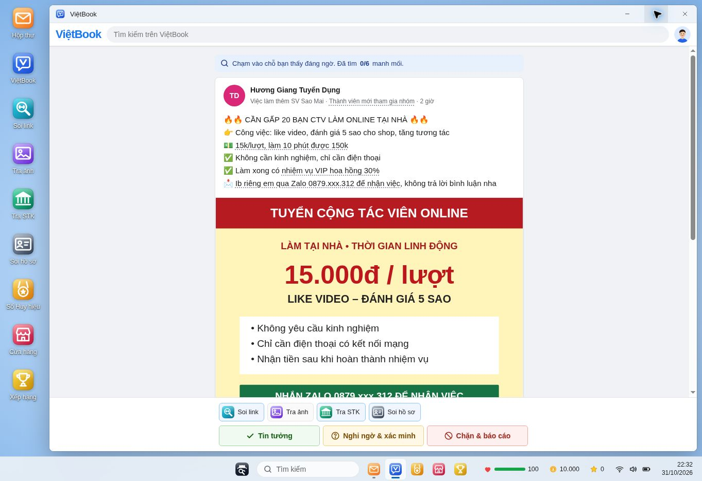
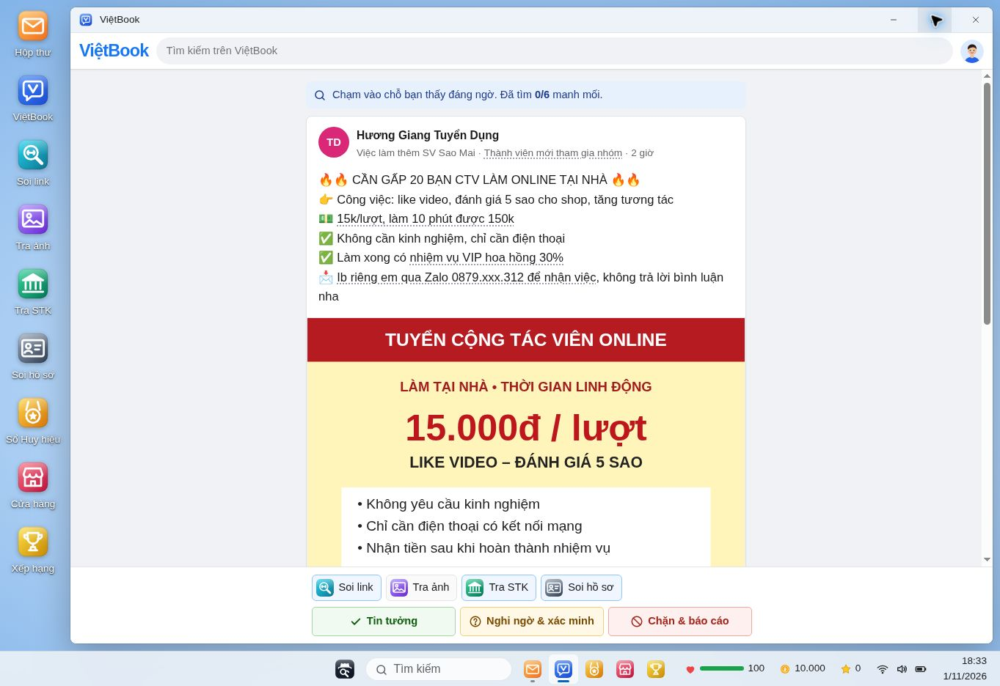
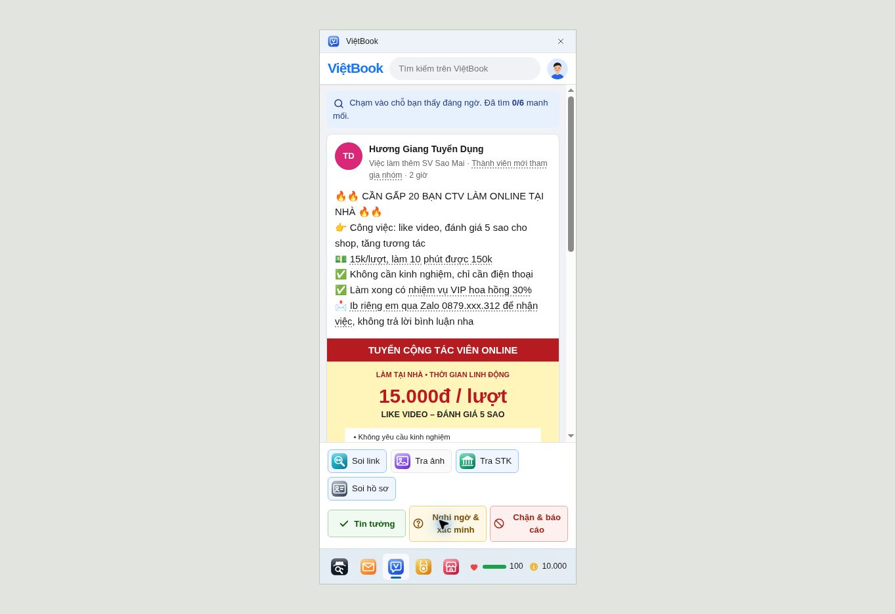

# Bố cục gốc · tài khoản test · bài đăng đối chiếu tin cảnh báo

Bản này giữ desktop, nền, bộ icon, menu Start, thanh tác vụ và cách quản lý cửa sổ của mã nguồn gốc `daaaf32`. Các thử nghiệm thay bố cục và icon ở những bản trước đã được gỡ.

## Chạy thử

Giải nén vào thư mục mới, vào `tham-tu-mang` rồi mở `index.html`. Nếu cần chạy bằng web server, dùng Live Server trong VS Code hoặc `python3 -m http.server 8000` và mở http://localhost:8000.

## Tài khoản thử nghiệm

- Tên đăng nhập: `admin_test`
- Mật khẩu: `Test@12345`
- Hoặc nhấn **Vào tài khoản thử nghiệm (mở tất cả chương)** trên màn hình đăng nhập.

Tài khoản demo công khai này mở đủ 7 chương (42 vụ) và chuyên án Bóng Đêm ngay từ đầu, có 10.000 tiền thưởng và 4 công cụ cấp 3. Không đánh dấu các vụ là đã hoàn thành; vẫn có thể chơi và thử kết quả bình thường. Mỗi lần vào lại tài khoản test sẽ hồi đầy máu và bổ sung tiền test tối thiểu 10.000.

Đây là tài khoản thử nghiệm của trò chơi, không phải tài khoản có quyền quản trị Firebase. Tiến trình lưu riêng trong trình duyệt, không lên bảng xếp hạng và không sửa tiến trình tài khoản thường/khách. Tài khoản thường vẫn mở chương theo số sao như trước. Mật khẩu và nút vào demo đều được cung cấp công khai để tiện trình diễn.

## Đổi phông chữ bằng code

Mở `css/readability.css`, chỉnh hai biến ở đầu file:

```css
:root {
  --font: "Segoe UI", Arial, sans-serif;
  --font-display: var(--font);
}
```

Ví dụ muốn dùng Tahoma thì thay `"Segoe UI"` bằng `Tahoma`. Lưu file, tải lại trang bằng Ctrl+Shift+R. Không cần dịch vụ font bên ngoài. Các tiêu đề, nội dung và nút dùng cùng hệ phông; tiêu đề không còn dùng Baloo 2. File `css/style.css` gốc vẫn giữ nguyên để dễ đối chiếu.

## Bài đăng

Đã rà cả 8 vụ dạng post: Vòng quay iPhone; Bốc thăm Ngày hội; CTV like video 15k; Quán sách tuyển part-time; Tài liệu ôn thi; Hoàn tiền giao dịch lỗi; Thông báo của Phòng CTSV; Vay 0% lãi.

- Bài đăng và bảng thao tác bên dưới giới hạn 600 px, căn giữa khi cửa sổ rộng. Khi màn hình hẹp, bài co theo chiều rộng còn lại.
- Tên người đăng, địa chỉ link và bình luận tự xuống dòng; ảnh không bị kéo giãn.
- Có nút **Xem ảnh**, mở ảnh/tài liệu trong hộp xem lớn. Nút xem ảnh không tự tính là tìm được manh mối; bấm vào ảnh có gắn manh mối vẫn hoạt động như cũ.
- Kích thước ảnh được khai báo sẵn để không nhảy bố cục khi chọn manh mối.
- Bốn vụ trúng thưởng iPhone, CTV, mạo danh ví điện tử và vay nhanh có ảnh quảng cáo dựng lại theo nội dung thủ đoạn trong các nguồn đã đối chiếu. Phân biệt rõ chi tiết tham khảo và chi tiết hư cấu tại `NEWS-SOURCES.md`; không dùng ảnh báo chí như ảnh của nhân vật trong game. Ảnh sản phẩm iPhone và quán cà phê có ghi nguồn, giấy phép trong `img/SOURCES.md`.
- Bổ sung hàng tương tác, kiểu avatar chữ cái và chữ bình luận cho toàn bộ bài post. Nguồn đối chiếu xuất hiện trong phần kết quả sau khi phá án, có thể mở từng liên kết để kiểm tra.
- Không thay đáp án, số manh mối hoặc quy tắc chấm điểm. Mô tả manh mối ảnh học bổng và mô tả tra ảnh iPhone được chỉnh để khớp ảnh mới.

## Kiểm tra đã thực hiện

- `node tests/demo-account.test.cjs`: mật khẩu đúng/sai, tên demo được giữ riêng, lưu tiến trình tách biệt, không ghi bảng xếp hạng, tài khoản thường còn đăng nhập được; giả lập online xác nhận demo không gọi đăng nhập hay ghi Firestore.
- Kiểm tra cú pháp JavaScript; `git diff --check`.
- Trình duyệt: tài khoản test thấy 42 nút hồ sơ; mở được chuyên án Bóng Đêm; công cụ hiển thị cấp 3. Tài khoản khách mới vẫn chỉ thấy 6 vụ chương đầu.
- Mở đủ 8 bài post, kiểm tra ảnh tải được, không tràn ngang và mở được ảnh lớn.
- Chọn manh mối ảnh học bổng rồi mở ảnh lớn ngay: vẫn đúng thao tác, không bị dịch nút.
- Phóng to cửa sổ: bài giữ đúng 600 px trong vùng xem rộng 1.242 px. Kiểm tra iframe rộng 390 px: bài rộng 355 px, không tràn ngang.
- Chưa chơi hết mọi nhánh của cả 42 vụ hoặc kiểm thử đăng ký/đăng nhập Firebase với tài khoản thật. Kiểm tra màn hình 390 px không thay cho thiết bị điện thoại thật.

## Đưa vào repository

Chép bản này vào repository hiện có sau khi sao lưu. Các file chính thay đổi so với bản gốc: `index.html`, `css/readability.css`, `js/game.js`, `js/store.js`, `js/data.js`, ảnh trong `img/posts`, ảnh iPhone và ghi nguồn. `js/icons.js` và `css/style.css` khớp bản gốc. Mã nguồn được quản lý tại thamtumang/thamtumang.github.io. Không cần xóa localStorage.



## Kiểm tra bổ sung cho bản đối chiếu tin cảnh báo

- Mở bốn mẫu mới trên trình duyệt; ảnh iPhone ghép hiển thị đủ, ảnh vay nhanh mở được trong modal, ảnh CTV và ví điện tử tải thành công.
- Phá vụ CTV, mở phần nguồn và kiểm tra hai liên kết; không có khối nguồn trong lúc điều tra.
- Bài CTV rộng 600 px khi phóng to. Bài ví điện tử trong iframe 390 px rộng 355 px; vùng bài không tràn ngang.
- Đối chiếu tự động xác nhận cả 42 đáp án, bộ manh mối, dữ liệu công cụ và nội dung chữ của các bài post không bị thay đổi trong lần sửa này.

## Cỡ chữ thích ứng màn hình (01/11/2026)

File `css/typography.css` được nạp cuối cùng, quản lý toàn bộ cỡ chữ theo một thang chung. Thay `--type-base` để chỉnh tỷ lệ chung; thay `--text-reading`, `--text-caption`, `--text-ui`, `--text-heading` để chỉnh từng vai trò. Phông chữ vẫn đổi tại đầu `css/readability.css`.

```css
--type-base: clamp(14px, calc(11.5px + .3vw), 17px);
```

Chữ thay đổi theo chiều rộng vùng hiển thị của trình duyệt (CSS pixel), có giới hạn tối thiểu/tối đa để dễ đọc. Không dựa vào kích thước vật lý hay chỉ số DPI của màn hình. Thu hẹp cửa sổ hoặc mở trên màn hình rộng sẽ điều chỉnh thang chữ; phóng to một cửa sổ con trong game không làm chữ tăng riêng.

| Chiều rộng | Nội dung đọc | Thông tin phụ | Nút | Tiêu đề |
|---|---:|---:|---:|---:|
| 390 / 768 px | 14,88 px | 12,25 px | 13,13 px | 19,25 px |
| 1280 px | 16,30 px | 13,42 px | 14,38 px | 21,09 px |
| 1366 px | 16,57 px | 13,65 px | 14,62 px | 21,45 px |
| 1920 / 2560 px | 18,06 px | 14,88 px | 15,94 px | 23,38 px |

Các giá trị trên được đo bằng computed style trong trình duyệt ở các iframe tương ứng. Đã kiểm tra thêm giao diện game thực tế ở khung 390px và vùng hiển thị desktop 1363px: bài đăng lần lượt rộng 355px và 600px, không tràn ngang. Rà cửa hàng, sổ huy hiệu và tin trình báo. Ảnh tin nhắn trình báo tăng chữ từ 8–9px lên cỡ chú thích chung, khung tự dài theo nội dung. Đoạn gợi ý manh mối xuống dòng như một câu thay vì tách từng khối flex.

Không sửa JavaScript, nội dung vụ án, ảnh quảng cáo, điểm hay lưu tiến trình trong lần cập nhật này. Đây là kiểm tra trên trình duyệt với iframe giả lập, không phải kiểm tra trên từng thiết bị vật lý. Chữ nằm bên trong ảnh/SVG vẫn co theo ảnh, không sử dụng thang chữ HTML.




## Ca trực an toàn số (05/11/2026)

Thêm biểu tượng Ca trực ở cuối danh sách desktop và nút truy cập trong Hộp thư. Hai ca điều tra mới có hội thoại theo lựa chọn, nguồn xác minh, sổ đối chiếu và kế hoạch ứng phó. Xem [SHIFT-README.md](SHIFT-README.md) để biết cách chơi, điểm và phạm vi.
