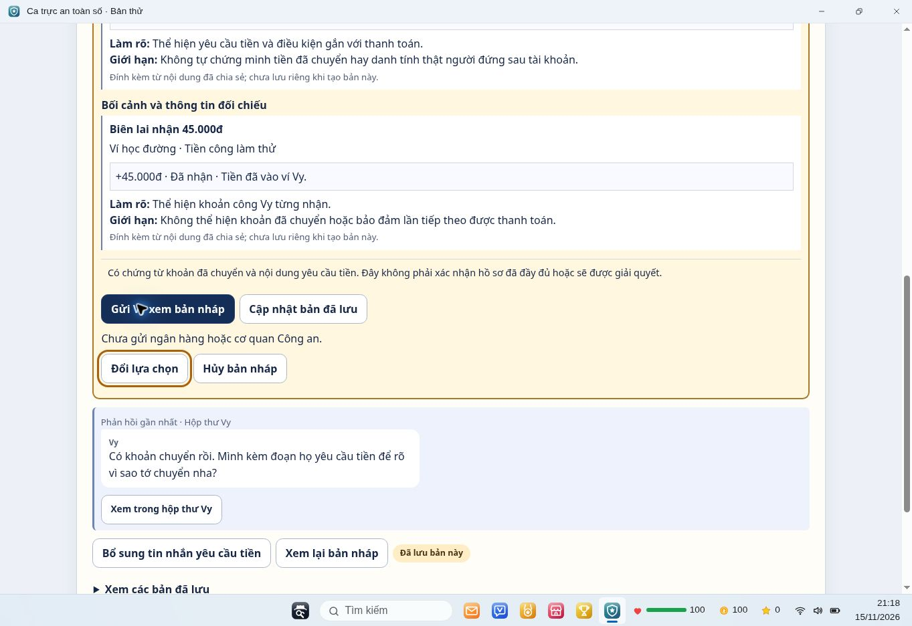
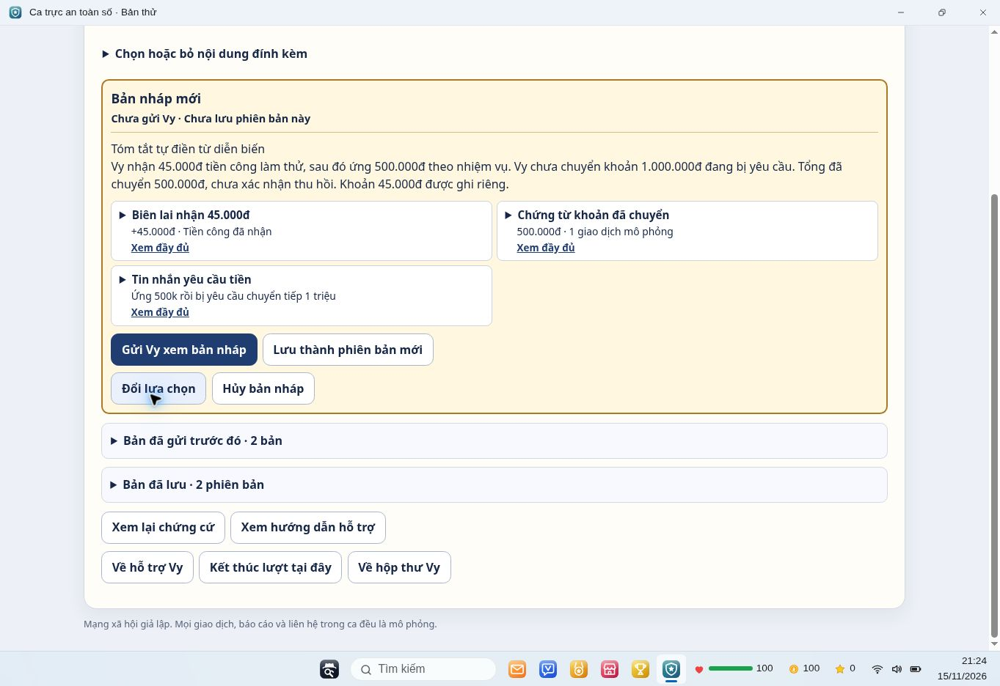
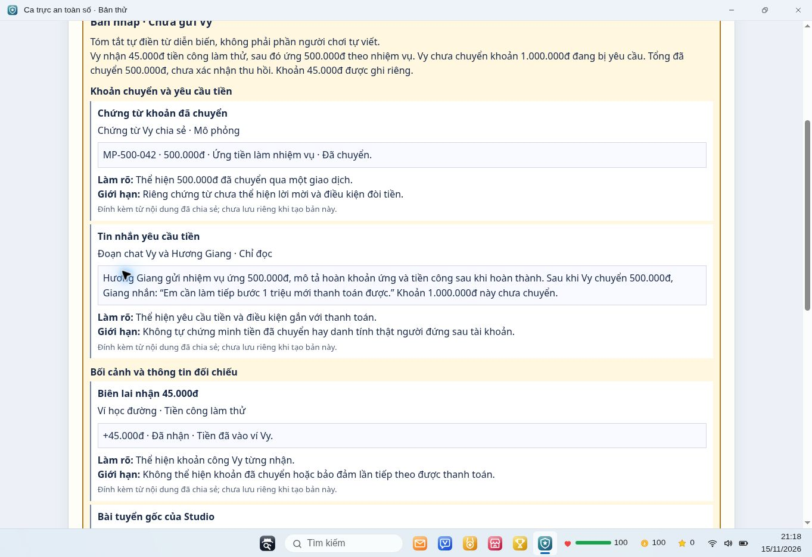
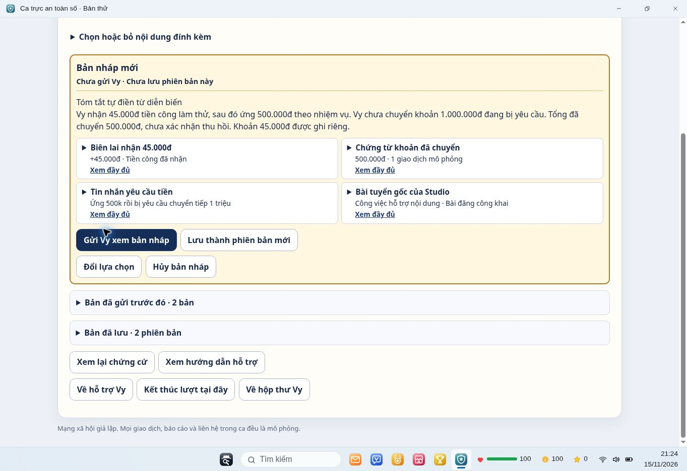
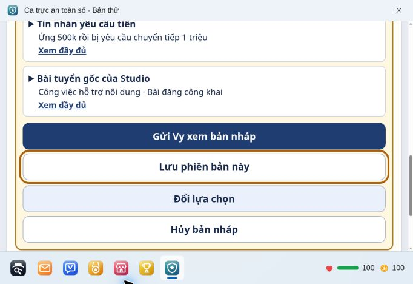

# Vy — tách nháp, bản gửi và bản lưu

Ngày kiểm: 15/11/2026 (giờ Việt Nam). Mốc trước sửa: `11ac6cee5758a2f71e9cf973ff7f8698a0af248f`.
Bản runtime đã thấy trên Pages: `b6f590b2ca33bb4bbd92b768a9a213b464f9711b`, cache `ca-vy-dossier-layout-v1`.

## Đường vào và phạm vi

UI kiểm qua https://thamtumang.github.io/game-goc.html → Chơi thử không cần tài khoản → nhấp đúp Ca trực. Chuỗi nạp được đối chiếu: `game-goc.html` → `js/game.js` → iframe `ca-truc/ban-thu/index.html` → `app.js`.

Chỉ sửa trình bày bản chuẩn bị. Không đổi nguồn, cốt truyện, câu hỏi, phản hồi theo tập tài liệu, kết thúc, dữ liệu ca Minh hoặc đăng nhập. Các thay đổi game-goc/index/js game chỉ cập nhật URL cache.

## Vấn đề tái hiện trước sửa

1. Gửi và lưu biên lai 45k, gửi/lưu bản bổ sung chứng từ, thêm tin nhắn vào nháp mới: bên dưới nháp vẫn có phản hồi của bản trước và nhãn “Đã lưu bản này” không gắn số phiên bản. Không thấy nháp mới thực sự bị lưu giả.
2. Nháp bốn tài liệu mở sẵn toàn bộ nội dung, nguồn, làm rõ, giới hạn và thông báo lưu riêng. Cao 1261,75 px trong viewport iframe 1363×853; nút gửi ở khoảng y=1080, ngoài vùng nhìn.

## Cách xử lý

- Vùng đang xem ghi độc lập trạng thái gửi và lưu, gắn số bản gửi/bản lưu khi đã có. Nháp mới không lẫn trạng thái của bản cũ.
- Lịch sử gửi nằm trong vùng thu gọn riêng. Mở từng bản thấy đúng lời Vy phản hồi cho bản đó. Bản lưu có khu riêng, không thay nội dung lịch sử.
- Mỗi tài liệu mặc định chỉ có tên, dòng xem trước và nút mở đầy đủ bằng native details/summary. Mở ra vẫn có nguồn, nguyên văn, làm rõ và giới hạn; mở được nhiều mục cùng lúc. Trạng thái mở được lưu bằng cơ chế disclosures hiện có.
- Thao tác ngay sau danh sách gọn. Bản đã gửi/lưu dùng “Đóng phần xem”, nháp chưa gửi/lưu vẫn có “Hủy bản nháp”. Gửi không lưu, lưu không tạo chat.
- Bản cùng nội dung đã tồn tại được nhận diện cả trong lịch sử, không mời gửi/lưu lại thành bản mới. Nút lưu cạnh tin đã gửi nhắm đúng snapshot của tin đó, kể cả khi đã có nháp khác chưa gửi. Hai điểm này được kiểm tự động, không thêm bước chơi.

## Kết quả UI thực tế

| Lượt | Đã thấy trên Pages |
| --- | --- |
| A — Bản cũ và nháp mới | Hai bản đã gửi/lưu riêng. Nháp thêm tin nhắn ghi chưa gửi/chưa lưu. Phản hồi cũ mặc định ẩn; mở bản gửi 2 thấy đúng lời Vy về bản chỉ có biên lai và chứng từ. Không còn nhãn trống ngữ cảnh “Đã lưu bản này”. |
| B — Bốn tài liệu | Mặc định cả bốn thu gọn. Nháp cao 457,06 px trên cùng viewport 1363×853; nút gửi khoảng y=420–464, trong vùng nhìn. Mở bằng Enter/Space được hai tài liệu đồng thời, đọc đủ nội dung và giới hạn; đóng một không đóng mục kia. |
| C — Lưu trước gửi sau | Lưu bản chứng từ + tin nhắn: ghi chưa gửi/đã lưu bản 1; chưa có lịch sử gửi hay phản hồi Vy. Gửi sau tạo đúng một tin và một lời đáp. Vùng đang xem nhận diện cả bản gửi 1 và bản lưu 1. |
| D — Gửi trước lưu sau | Gửi bản biên lai 45k: có một tin, vẫn có nút lưu bản đã gửi. Lưu sau chỉ đổi trạng thái lưu. Đã thử tiếp bản bổ sung thứ hai; số tin vẫn đúng hai. |
| E — Sửa rồi hủy | Nháp ba tài liệu hủy không tạo thêm tin, không ghi đè hai bản lưu. Sau khi đọc/mở/đóng căn cứ và quay về inbox vẫn chỉ hai tin gửi hồ sơ. |
| F — Thêm giao dịch | Có bản lưu 500k, chủ động xác nhận chuyển tiếp 1 triệu. Trở lại thấy cảnh báo và bản cũ 500k/1 giao dịch. Cập nhật nháp hiện 1,5 triệu/2 giao dịch; mở đầy đủ thấy cả MP-500-042 và MP-1000-043. Bản lưu 1 vẫn 500k. |
| G — Đóng/mở và tải lại | Nháp bốn tài liệu có một mục đang mở: đóng riêng Ca trực rồi mở lại giữ nháp, bốn lựa chọn và đúng một mục mở. Tải lại khách: không lựa chọn, không nháp, không bản lưu. Tài khoản demo cũ mở được hội thoại và bản lưu legacy 500k, không tự gán lựa chọn/tin mới. Sau khi chủ động tạo nháp ở demo, tải lại và vào lại demo vẫn giữ nháp, bản cũ và trạng thái chưa gửi. |
| H — Bàn phím và khung hẹp | Native summary có trạng thái mở/đóng trong cây accessibility. Enter/Space mở, nút Thu gọn đóng đúng mục. Tab từ gửi tới lưu có focus rõ. Kiểm zoom 200% và 400%: nút xuống dòng, không tràn ngang. Đây không phải kiểm điện thoại chuẩn. |

## Ảnh cùng trạng thái trước/sau

Cặp nháp mới: đã có hai bản gửi/lưu, đang soạn ba tài liệu (biên lai, chứng từ, tin nhắn).

| Trước | Sau |
| --- | --- |
|  |  |

Cặp bốn tài liệu: cùng lựa chọn cả bốn, nháp chưa gửi/lưu, đã có hai bản cũ. Ảnh trước chỉ thấy phần nội dung dài, nút gửi ở dưới vùng nhìn; ảnh sau thấy toàn bộ danh sách gọn và thao tác.

| Trước | Sau |
| --- | --- |
|  |  |

## Kiểm kỹ thuật và giới hạn

Đạt: `node --check ca-truc/ban-thu/app.js`; `tests/vy-dossier.test.cjs`; `tests/vy-review.test.cjs`; `tests/vy-support.test.cjs`; `tests/shift.test.cjs`; `tests/demo-account.test.cjs`; `git diff --check`.

Bộ hồ sơ kiểm 16 tổ hợp, tách chọn/gửi/lưu, bản lỗi thời, snapshot bất biến, dữ liệu cũ; thêm kiểm lưu từ tin gửi khi có nháp khác và ngăn tạo lại bản đã có trong lịch sử. Hồi quy khác kiểm sửa nhận định, lịch sử, quyết định đã xác minh, một lần chuyển thêm và các trạng thái hỗ trợ riêng. Các kiểm này là tự động; bảng trên chỉ ghi điều đã quan sát qua UI.

Giữ `payment-v1`; không thêm migration hay cờ gameplay. Chỉ sử dụng disclosures đã có để nhớ mục mở. Không tự tạo hành động cho lượt cũ; snapshot cũ vẫn đọc trung tính, không phục dựng thông tin mà dữ liệu cũ thiếu.

Kích thước: desktop viewport iframe 1363×853; zoom 200% khoảng 681×379, zoom 400% khoảng 340×145. Không có API đổi viewport điện thoại trong browser hiện tại. Thử bỏ maximize cửa sổ không đổi kích thước, nên báo đúng là zoom desktop; chưa kiểm 390×844/360×800, cảm ứng, trình đọc màn hình hoặc toàn bộ thứ tự Tab. Chưa kiểm tài khoản Firebase thật; đã kiểm tài khoản demo lưu local có dữ liệu cũ.

Máy chủ local không truy cập được từ browser kiểm thử (connection refused). Đã chạy kiểm kỹ thuật trước khi xuất bản candidate, rồi chạy UI trên Pages và xác nhận cache cùng hành vi mới qua đường vào thật. Commit bổ sung biên bản/ảnh không đổi runtime. Không suy ra mức hấp dẫn hoặc hiệu quả học tập từ các kết quả này.
