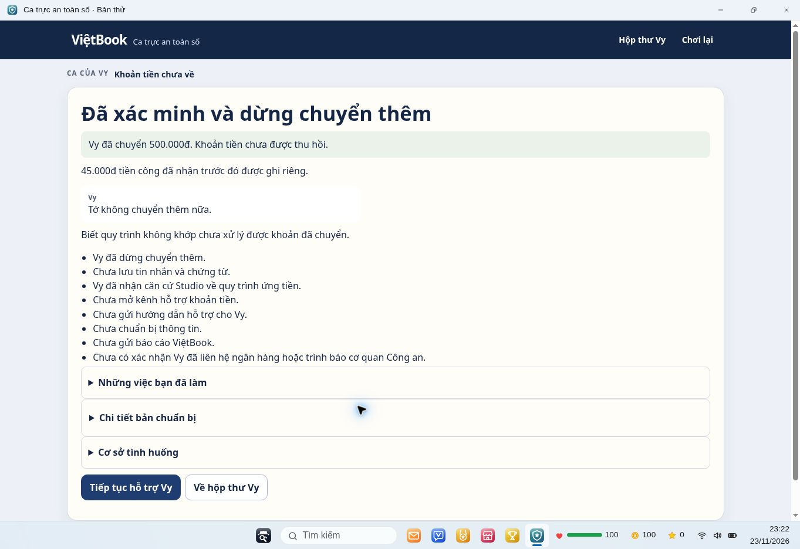
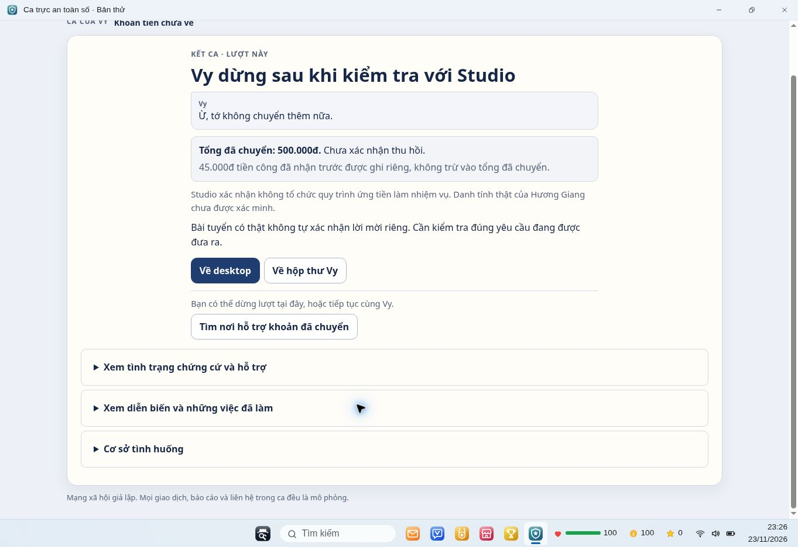
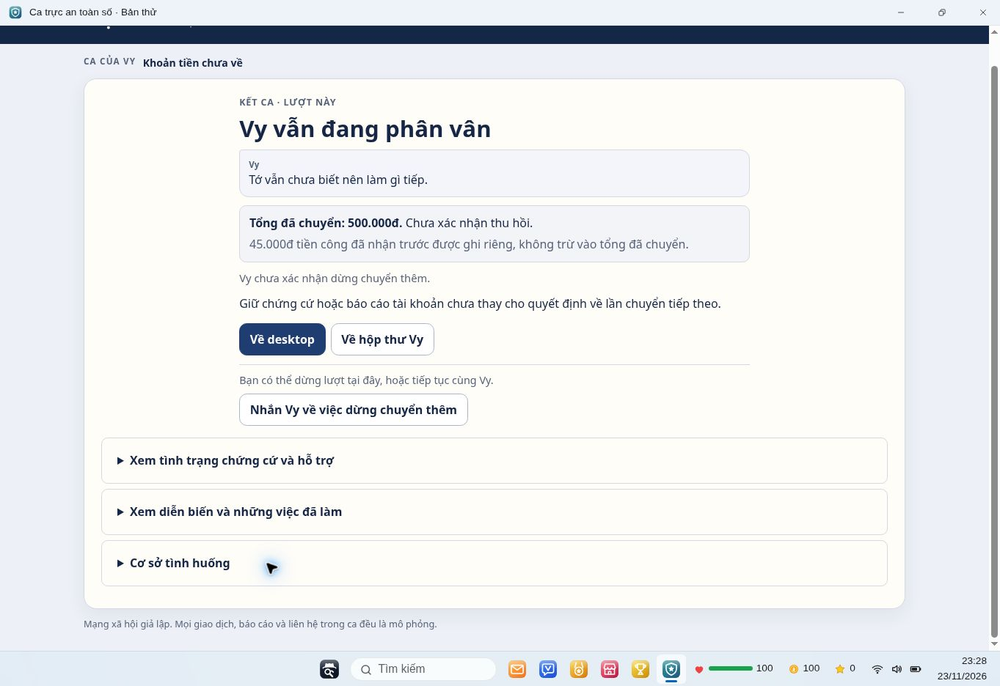
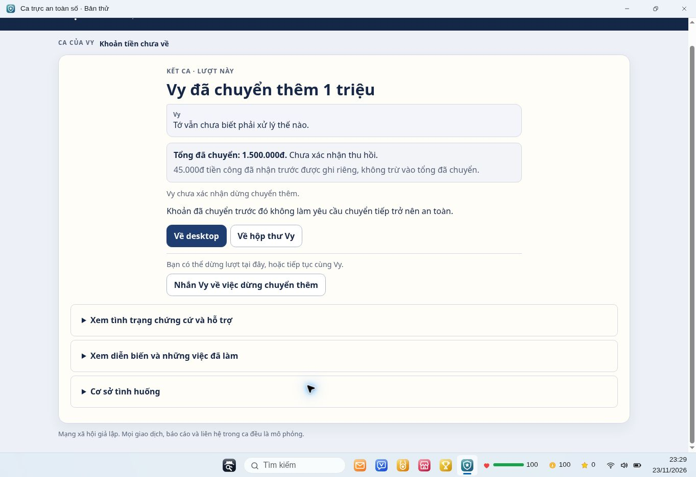
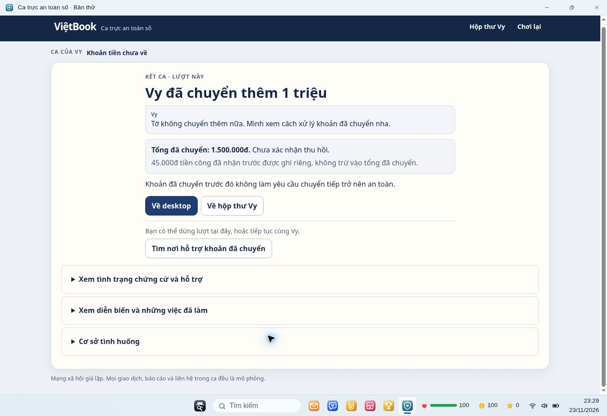
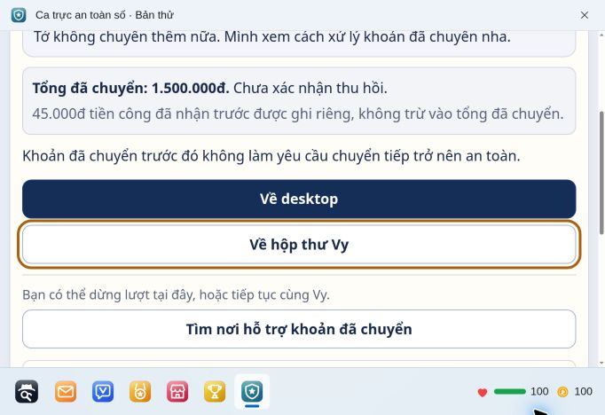

# Vy — điểm dừng ở màn kết

Kiểm ngày 23/11/2026 (giờ Việt Nam), từ mốc `5c1c2f31c69170b4594194cbe104c36767a86c06`. Không có thay đổi mới hơn trên main lúc bắt đầu.
Runtime mới đã quan sát trên Pages: `93da868864ebe12f563add20ad21fa124dfdad50`, cache `ca-vy-ending-v1`.

## Đường vào và phạm vi

Tất cả lượt UI qua https://thamtumang.github.io/game-goc.html → Chơi thử không cần tài khoản → nhấp đúp Ca trực. Chuỗi nạp: `game-goc.html` → `js/game.js` → iframe `ca-truc/ban-thu/index.html` → `app.js`.

Trước sửa đã tái hiện đúng: đọc chat chia sẻ → bài tuyển → trang/hộp thư Studio → hỏi quy trình → chuyển phản hồi → tổng kết. Vy dừng, 500k chưa thu hồi đúng, nhưng mặc định hiện hàng loạt trạng thái chưa hỗ trợ và nền hậu quả màu xanh nhạt.

Sau sửa: kết quả → một lời Vy → tình trạng tiền và giới hạn xác minh → một thông điệp → lối rời cửa sổ và lời mời hỗ trợ tùy chọn → ba mục chi tiết đóng mặc định. Không thêm câu hỏi, điểm, tình huống hoặc yêu cầu phải làm đủ hỗ trợ.

## Kết quả UI thực tế

| Lượt | Quan sát |
| --- | --- |
| A — Tạm chờ / xác nhận dừng chưa xác minh | Thử cả lựa chọn Khoan chuyển từ đầu rồi kết thúc, và vào hỗ trợ nhắn dừng ngay. Tạm chờ được ghi đúng “Vy đang chờ kiểm tra”, không biến thành quyết định dừng lâu dài. Khi Vy xác nhận dừng, tiêu đề ghi dừng, yêu cầu chưa kiểm tra qua Studio và 500k chưa xác nhận thu hồi. Lời mời khi đã dừng mở màn chọn kênh hỗ trợ. |
| B — Xác minh rồi dừng, chưa hỗ trợ | Hỏi đúng, chuyển phản hồi, tổng kết nêu Studio không tổ chức ứng tiền và danh tính Giang chưa xác minh. Không hiện mặc định danh sách các việc chưa làm; ba vùng chi tiết đóng. Về desktop không cần làm hồ sơ. |
| C — Chỉ lưu chứng từ, chưa nhắn dừng | Kết thúc “Vy vẫn đang phân vân”, 500k chưa xác nhận thu hồi; nói rõ chưa xác nhận dừng. Lời mời mở màn có nút nhắn Vy, chưa tự gửi. Trạng thái chỉ báo cáo riêng được kiểm tự động, không chạy một lượt UI báo cáo-only trong vòng này. |
| D — Chuyển thêm trước/sau khi nhắn dừng | Cả hai kết thúc giữ tổng 1,5 triệu chưa xác nhận thu hồi. Trước dừng: Vy chưa biết xử lý, gợi ý nhắn về chuyển thêm. Sau nhắn dừng: Vy nói không chuyển nữa, gợi ý tìm nơi hỗ trợ. |
| E — Chỉ mở nguồn | Sau khi đã dừng, mở hướng ngân hàng rồi về tổng kết: gợi ý quay lại đúng `bankHelp`. Chi tiết ghi đã mở, chưa gửi hướng dẫn và chưa xác nhận liên hệ. |
| F — Đã gửi hướng dẫn, chỉ lưu chứng từ | Gửi hướng ngân hàng, lưu chứng từ, tổng kết vẫn 500k chưa thu hồi; lời mời mở chứng cứ. Chi tiết ghi thiếu tin nhắn, đã gửi hướng dẫn, chưa xác nhận liên hệ hoặc trình báo. Không gọi xử lý xong. |
| G — Bản lưu cũ và nháp hủy | Lưu bản chỉ có biên lai 45k, thêm tin nhắn vào nháp rồi hủy. Chi tiết ghi lựa chọn chưa phải gửi/lưu, chưa gửi Vy, vẫn giữ bản lưu 500k. Timeline chỉ có lần lưu thực, không có lần gửi/lưu nháp hủy. Thứ tự hỏi Studio → chuyển phản hồi → mở/gửi hướng dẫn → lưu chứng từ → lưu bản chuẩn bị còn nguyên. |
| H — Desktop, khách và tài khoản | Về desktop đóng riêng Ca trực; mở lại đúng màn kết đã xác minh. Tải lại khách trở về 500k, không tin gửi và không lối tổng kết của lượt trước. Tài khoản demo trong browser này bắt đầu sạch; tạo kết dừng, về desktop, tải lại và vào lại demo giữ đúng kết dừng/500k. Không có sẵn lượt demo trước cập nhật để kiểm trực tiếp; dữ liệu cũ kiểm bằng VM. |
| I — Desktop, bàn phím và zoom | Desktop iframe 1363×853, đọc được tiền và nút chính. Enter/Space mở hai vùng chi tiết đồng thời; đóng một giữ vùng còn lại. Tab hiển thị focus rõ. Zoom 200% và 400%: nút xuống dòng, không tràn ngang. Không gọi đây là điện thoại thật. |

Đã thử bấm lời mời nhắn Vy: vào đúng màn hỗ trợ với nút “Nhắn Vy dừng chuyển thêm”, chưa tự chốt quyết định. Những lời mời khác chỉ là liên kết đến màn hiện có; mở nguồn vẫn dùng việc ghi nhận đã mở hiện hành, không tự gửi hướng dẫn hoặc ghi đã liên hệ.

## Ảnh

Cùng trạng thái xác minh và dừng, chưa hỗ trợ (bản trước và sau đều từ đường vào thật):

| Trước | Sau |
| --- | --- |
|  |  |

| Chuyển thêm, chưa dừng | Chuyển thêm, đã dừng |
| --- | --- |
|  |  |

## Kỹ thuật, lưu lượt và giới hạn

- File chính: `ca-truc/ban-thu/app.js`, `style.css`. `js/game.js` cấp callback đóng riêng cửa sổ bằng `WM.close('caTruc')`, đúng cơ chế nút Đóng hiện có; focus trả về biểu tượng. Không dùng đóng tab, reset hoặc closeAll. Cache URL đổi ở game-goc/index/js game.
- Không đổi `payment-v1`, Store hoặc thêm migration. Không thêm cờ gameplay. Gọi về desktop lưu state hiện tại rồi đóng; trạng thái đọc/nháp/hồ sơ không bị xóa. Khi mở trực tiếp ca ngoài desktop, không hiển thị nút desktop giả nếu không có callback.
- Bộ `tests/vy-ending.test.cjs` kiểm 16 tổ hợp quyết định và số tiền, ưu tiên đích hỗ trợ, summary/CTA không gây tác dụng phụ, đóng cửa sổ giữ state và cấu trúc chi tiết thu gọn. Các bài kiểm dựa trên trạng thái và hành vi, không chỉ đối chiếu nguyên văn thoại.
- Đã đạt: `node --check ca-truc/ban-thu/app.js`, `node --check js/game.js`, `tests/vy-ending.test.cjs`, `tests/vy-review.test.cjs`, `tests/vy-dossier.test.cjs`, `tests/vy-support.test.cjs`, `tests/shift.test.cjs`, `tests/demo-account.test.cjs`, `git diff --check`. Các bộ này là kiểm tự động; không thay cho bảng UI phía trên.
- Zoom 200%: iframe khoảng 681×379. Zoom 400%: khoảng 340×145, scrollWidth 337, các nút nằm trong bề rộng. Chưa kiểm viewport điện thoại chuẩn, thiết bị cảm ứng, trình đọc màn hình hoặc toàn bộ thứ tự Tab. Chưa kiểm Firebase thật hoặc tài khoản cũ qua UI. Không chạy lại toàn bộ ca Minh bằng UI; kiểm hồi quy logic hiện có đã đạt.
- Không thêm hướng dẫn pháp lý/tài chính thực tế. Các nguồn hiện có giữ nguyên. Không suy ra hấp dẫn hoặc hiệu quả học tập hơn từ kiểm kỹ thuật; Chat A/người chơi mới cần đánh giá nhịp kết truyện.

Các kiểm kỹ thuật chạy trước khi xuất bản candidate, rồi UI được chạy trực tiếp trên Pages. Commit bổ sung ảnh/biên bản không thay đổi runtime đã quan sát.
