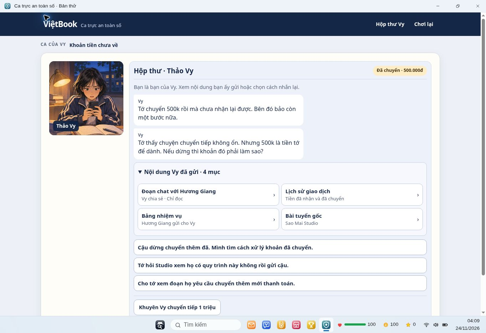
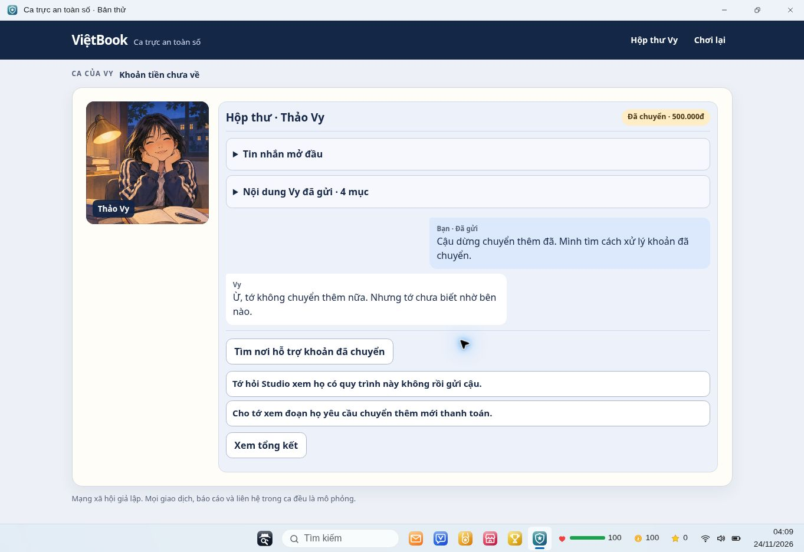
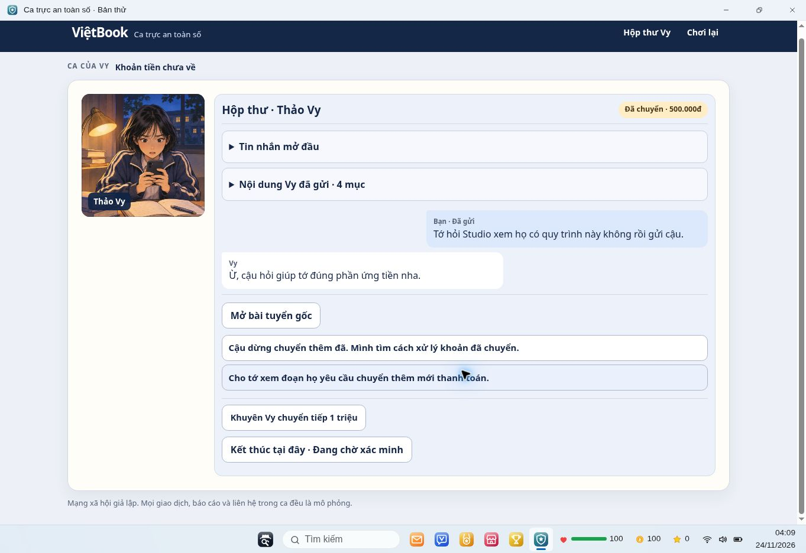
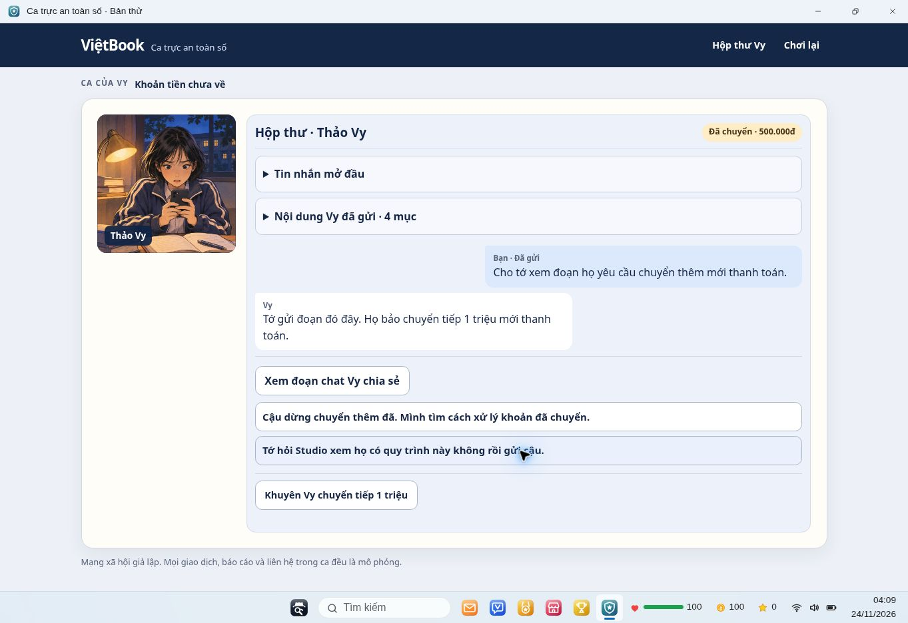
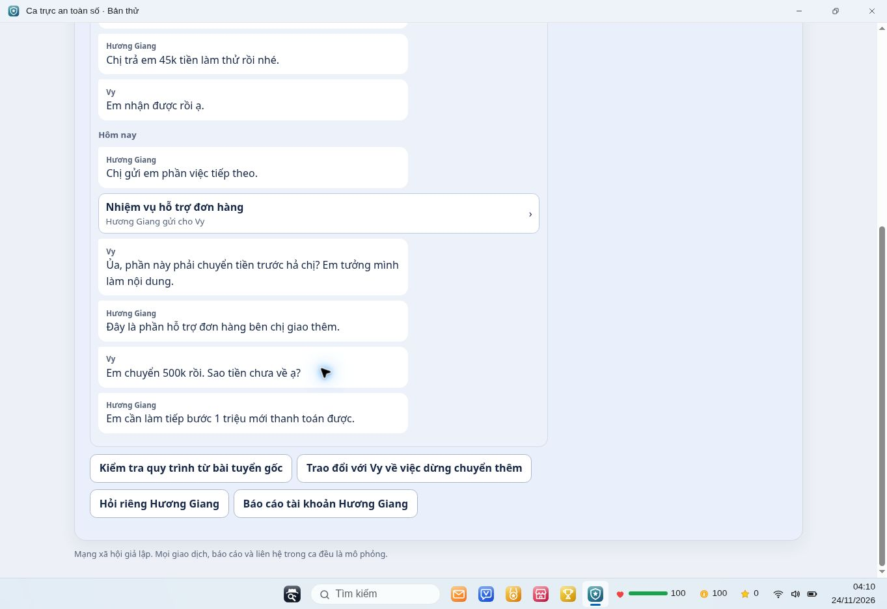
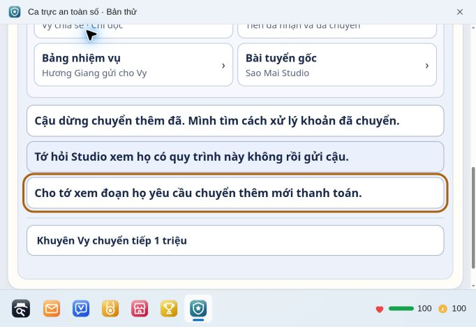

# Vy — ba cách giúp bạn ở cảnh mở đầu

Ngày kiểm: 24/11/2026 (giờ Việt Nam). Mốc bắt đầu `bbd8a0c557243d92a97ba5506f66837d760b1d81`; main không có thay đổi mới hơn lúc đối chiếu.
Runtime cuối đã thấy trên Pages: `a14646a7329163625e7d43a1ba9877edc1a1571c`, cache `ca-vy-scene-v3`.

## Phạm vi và đường vào

Tất cả lượt UI qua https://thamtumang.github.io/game-goc.html → Chơi thử không cần tài khoản → nhấp đúp Ca trực. Chuỗi nạp được đối chiếu: `game-goc.html` → `js/game.js` → iframe `ca-truc/ban-thu/index.html` → `app.js`.

Trước sửa đã mở bản công khai và thấy hai tin cũ, bốn nội dung cùng nút Khoan chuyển chung. Nay thay nút an toàn chung bằng ba lời nhắn A/B/C ngang ưu tiên; nhánh khuyên chuyển tiếp nằm riêng, nhãn nêu rõ 1 triệu. Không thêm điểm, đồng cảm, ca, nguồn nghiên cứu, câu hỏi hay hệ thống hỗ trợ mới.

## Tác dụng của ba hướng

- A: người chơi nhắn dừng và tìm hỗ trợ; Vy tự xác nhận dừng. Chưa hỏi Studio, mở/gửi hướng dẫn, lưu chứng cứ hoặc liên hệ. Lối kế tiếp mở màn chọn kênh đang có; tổng kết sớm vẫn hợp lệ.
- B: chỉ hứa hỏi, giữ tạm chờ bằng trạng thái paused đã có, không gọi đó là quyết định dừng. Người chơi tự mở bài, tìm trang và hộp thư, chọn câu hỏi, chuyển phản hồi. Nguồn đã tìm được tiếp tục có lối quay lại; câu trả lời đã có được xem lại thay vì hỏi trùng.
- C: chỉ đề nghị xem yêu cầu; câu nhắn chuyển thành xem lại nếu đã mở chat. Bấm link riêng mới mở bản chỉ đọc; focus vào tin Vy hỏi khoản 500k và lời Giang yêu cầu thêm 1 triệu. Bản đầy đủ vẫn cuộn đọc được. Không tự lưu hay xác minh.

## UI đã chạy

| Lượt | Kết quả quan sát |
| --- | --- |
| A — Dừng, hỗ trợ ngay | Vy xác nhận không chuyển thêm. Tổng kết 500k chưa xác nhận thu hồi, chưa xác minh. Mở được chọn kênh và nguồn ngân hàng mà không qua hồ sơ. |
| B — Hứa hỏi Studio | Trước khi nhắn hỏi thật, hộp thư Studio còn đủ hai nút câu hỏi và chưa có tin người chơi gửi. Sau hỏi quy trình, chuyển phản hồi mới dẫn đến kết dừng sau xác minh. |
| C — Xem yêu cầu tiền | Một tin người chơi + một lời Vy; bấm link mới mở chat. Vùng 500k/1 triệu được focus và nằm trọn trong viewport, còn đủ tin trước đó. Chat không có nút gửi tin trực tiếp. Trở lại vẫn chỉ một tin gửi của hướng C, tiền 500k. |
| D — Đã đọc trước | Mở chat từ thẻ trước, về Vy rồi chọn C: câu nhắn là xem lại, lời Vy chỉ đúng đoạn. Không tạo thêm bản chia sẻ hoặc phát lại mở đầu. |
| E — Đổi thứ tự | Đã chạy xem chat → C xem lại → B → hỏi quy trình → chuyển phản hồi; và A dừng → B → hỏi bài tuyển → gửi nhận định → hỏi quy trình → chuyển phản hồi. Lịch sử đúng thứ tự. Chỉ gửi xác nhận bài tuyển chưa được tính xác minh quy trình; Vy giữ quyết định dừng đã có. |
| F — Đã hỏi trước B | Từ thẻ bài tuyển đi thẳng hỏi quy trình rồi về Vy: không có tin hứa hỏi mới, thay bằng link xem phản hồi. Quay lại vẫn chỉ một câu hỏi trong lịch sử, không còn nút hỏi trùng và còn nút chuyển cho Vy. |
| G — Đổi ý / xác nhận chuyển | Khuyên chuyển rồi Khoan kiểm tra lại giữ 500k, không có tin Vy báo chuyển thêm. Khuyên lại và xác nhận rõ mới thành 1,5 triệu; tin báo chuyển chỉ một, nút xác nhận biến mất. Tổng kết giữ khoản chưa xác nhận thu hồi. |
| H — Sau xác minh | Không còn ba nút gửi cảnh mở đầu hoặc nút khuyên chuyển tiếp; tiền giữ 500k. Vẫn mở hỗ trợ và tổng kết như cũ. |
| I — Lặp, quay lại, đóng/mở, dữ liệu | Nút hướng đã gửi không mời gửi lại. Đóng Ca trực lúc đã gửi C rồi mở lại giữ một tin gửi, hai hướng chưa chọn và 500k. Tải lại khách sạch: ba hướng, không tin gửi, 500k. Đã mở lượt demo có sẵn từ bản cũ trước khi xuất bản và ghi nhận ba bubble lịch sử; sau cập nhật v3, ba bubble trùng nguyên văn, giữ lời mở đầu cũ, không tự gán A/B/C. Quyết định dừng cũ giữ nguyên, không có nút khuyên chuyển. |
| J — Desktop / zoom / bàn phím | Iframe desktop 1363×853: ba lựa chọn và nút chuyển tiếp nhìn thấy, bốn nội dung mở ngay từ đầu. Ba lựa chọn có cùng màu nền/chữ. Zoom 200% và 400% không tràn ngang; chữ và nút xuống dòng. Tab có focus rõ. Đây là zoom desktop, không phải kiểm điện thoại chuẩn hoặc cảm ứng. |

Đã kiểm bổ sung đường hộp thư Studio → chat chia sẻ → quay lại Studio: lịch sử một câu hỏi giữ nguyên, chuyển phản hồi vẫn dùng được. Khi nguồn đã được tìm thấy hoặc đã trả lời, các liên kết nguồn vẫn hiện ngay cạnh phản hồi phù hợp thay vì phải gửi lại lời hứa.

Các lượt đầu chạy trên v1/v2. V3 giữ thêm lối quay lại Studio sau khi gửi nhận định khác; sau đó đã chạy lại A, B, C, E (A trước B và chỉ xác nhận bài tuyển), F, G, dữ liệu demo cũ, khách sạch và zoom. Ảnh bàn giao đều được chụp lại trên v3. Lượt D và kiểm đóng/mở giữa lượt được quan sát ở v2; thay đổi v3 không chạm việc lưu hoặc lời xem lại.

## Ảnh

| A — dừng và tìm hỗ trợ | B — hứa đi hỏi |
| --- | --- |
|  |  |

## Số thao tác để tìm bước thừa

Đếm từ bấm chọn hướng, mỗi lần bấm nút/link là một thao tác; không đếm cuộn, thời gian đọc hoặc bước vào game. Đây là các mốc cụ thể, không phải thang năng lực.

| Hướng | Mốc quan sát | Số thao tác |
| --- | --- | --- |
| A | Vy xác nhận dừng | 1 |
| A | Màn chọn nơi hỗ trợ / đọc thẻ hướng ngân hàng | 2 / 3 |
| B | Mở bài tuyển gốc | 2 |
| B | Nhận phản hồi Studio về quy trình | 5: chọn B → bài → trang → hộp thư → hỏi |
| B | Chuyển phản hồi để Vy quyết định | 6 theo đường trực tiếp; các lần mở chat xem lại là tùy chọn và tính riêng |
| C | Đọc đúng đoạn yêu cầu tiền | 2: chọn C → mở chat |

Đường B có thêm một tin hứa hỏi so với mở thẳng bài từ thẻ. Người chơi vẫn được bỏ qua lời hứa và đi thẳng tới nguồn. Không thêm các nút xác nhận liên tiếp trong A/B/C; riêng nhánh chuyển tiền vẫn có bước Vy hỏi lại cần thiết. Phần gửi nhận định qua nháp là cơ chế cũ, không phải bước mới bắt buộc của cảnh.

## Lưu lượt và kiểm tự động

Giữ `payment-v1`. Chỉ thêm `sceneSent` để nhớ các hướng đã thực sự gửi và `openingVersion` để giữ lời mở đầu cho lượt cũ. Tin đã gửi được lưu nguyên văn như các tin hiện có; không dựng lại từ lựa chọn hiện tại. Lượt thiếu openingVersion dùng lời mở đầu cũ, không tự sinh tin hoặc lịch sử hành động. Chơi lại riêng ca / khách sạch dùng mở đầu mới. Không sửa Store, đăng nhập hoặc ca Minh; `game-goc.html`, `js/game.js`, index chỉ đổi cache URL.

Kiểm đạt: `node --check ca-truc/ban-thu/app.js`; `tests/vy-scene.test.cjs`; `tests/vy-ending.test.cjs`; `tests/vy-review.test.cjs`; `tests/vy-dossier.test.cjs`; `tests/vy-support.test.cjs`; `tests/shift.test.cjs`; `tests/demo-account.test.cjs`; `git diff --check`. Bộ cảnh kiểm tác dụng từng hướng, hỏi/gửi/mở tách biệt, thứ tự, nguồn đã trả lời, chống gửi lặp, xác nhận tiền và dữ liệu cũ. Các kết quả này là tự động, tách khỏi bảng quan sát UI phía trên.

## Nhận xét bản thử và giới hạn

Hành vi đã thấy: ba hướng dẫn tới ba việc khác nhau; A cho một việc cụ thể sau khi dừng, B vẫn để người chơi tự tìm/nhắn nguồn, C định vị được yêu cầu tiền. Mở đầu vẫn hai tin, hướng đã gửi thu khỏi lựa chọn; quay lại không phát lại mở đầu. C vẫn lặp ngắn ý 1 triệu trước khi mở nguồn, còn B có chi phí một lượt hứa hỏi. Chưa thể coi các chi phí đó là có ích với học sinh chỉ qua kiểm của AI.

Giả thuyết thiết kế: chọn cách giúp bạn có thể tạo cảm giác tự chủ hơn chọn nhận định đúng/sai. Đây chưa phải kết luận thực nghiệm. Cần người chơi thật kiểm xem có nhận ra ba tác dụng, muốn dùng các hướng hay chỉ mở thẻ thẳng, và có thấy phản hồi giúp mình quyết định tiếp hay chỉ làm tăng số bấm.

Chưa kiểm Firebase thật, điện thoại cảm ứng, viewport chuẩn 360×800/390×844, trình đọc màn hình hoặc toàn bộ thứ tự Tab. Zoom 200% có iframe khoảng 681×379; zoom 400% khoảng 340×145, scrollWidth 337. Không chạy lại toàn bộ ca Minh bằng UI; hồi quy logic đã đạt. Không thêm nguồn nghiên cứu hay khẳng định tâm lý mới; động cơ tiền để dành là chi tiết hư cấu theo yêu cầu.

Kiểm kỹ thuật chạy trước khi xuất bản candidate; UI kiểm trực tiếp trên Pages sau triển khai. Commit ảnh/biên bản cuối không đổi runtime đã quan sát.
