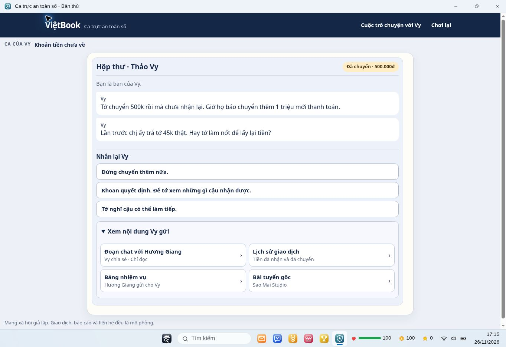
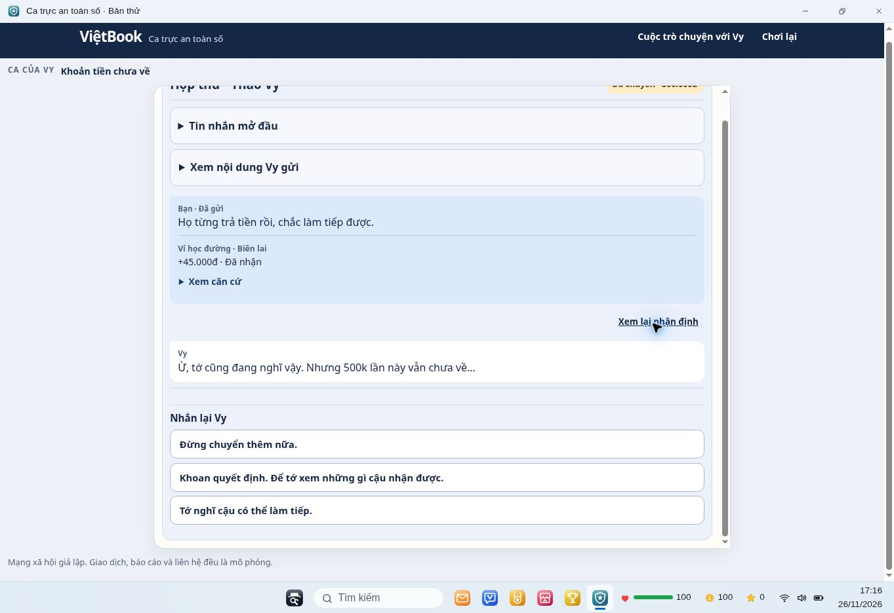
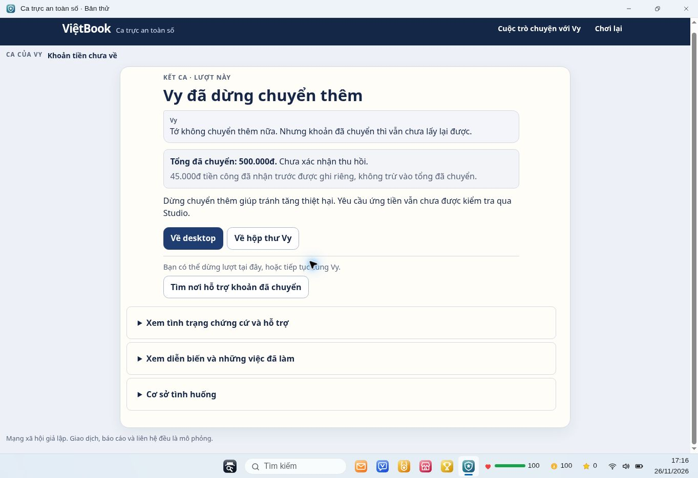

# Ca Vy rút gọn — kiểm thử 26/11/2026

Runtime: `e651224bf1d99691046b161c86f1760d4c219c18` (`ca-vy-short-v1`).
Đường đã trực tiếp dùng: https://thamtumang.github.io/game-goc.html → Chơi thử không cần tài khoản → nhấp đúp Ca trực.
Mốc trước: `a720c0301f70e14c196a5e6c18a6936365af2165` / runtime hub-v3.

## Đích sửa

Tập trung quyết định: Vy sợ mất 500k và muốn chuyển tiếp. Ba lời khuyên nằm ngay dưới hai tin mở đầu, cùng mức nổi bật. Bốn nguồn mở được từ đầu; gửi căn cứ lần đầu trực tiếp từ nguồn. Không thêm tình tiết, điểm số hay đếm ngược.

| Giữ | Thay | Bỏ khỏi đường chính |
| --- | --- | --- |
| Chat Vy và một khung nguồn; bài → trang → hộp thư Studio | Hai tin mở đầu nêu đủ 500k, yêu cầu thêm 1 triệu và 45k từng nhận | Menu phải mở trước khi chọn lời khuyên |
| Câu hỏi bài tuyển và quy trình có phạm vi khác nhau | Ba lựa chọn trực tiếp; nhóm nguồn mở sẵn ở lượt mới | Đối chiếu 2/2: chuyển vào Xem thêm tại nguồn |
| Xem căn cứ, chủ động sửa nhận định và lịch sử cũ | Căn cứ 45k/bài tuyển có phản hồi riêng theo diễn giải | Hồ sơ và việc bổ sung bản chuẩn bị: tùy chọn |
| Xác nhận riêng trước chuyển thêm, báo cáo có xem trước | Vy nhớ quyết định dừng; trả lời đúng tổng tiền sau xác minh | Lượt hứa hỏi/xem trước khi mở nguồn không còn trong lựa chọn mặc định |
| Hỗ trợ, lưu từng loại bằng chứng, nguồn hướng dẫn cũ | Lời mở đầu mới chỉ áp dụng lượt mới | Không bắt quản lý nháp/phiên bản trước gửi căn cứ lần đầu |

## Kiểm qua giao diện Pages

Trong lần mở đầu sau push vẫn còn hub-v3. Không dùng lần đó để xác nhận đã phát hành. Sau khi Pages triển khai, tải lại đường vào thật thấy lời 45k mới, ba nút trực tiếp và nhóm bốn nguồn mở sẵn; sau đó mới chạy bảng dưới.

| Nhóm | Đã thực hiện | Kết quả quan sát |
| --- | --- | --- |
| A | Lượt khách sạch → dừng ngay → tổng kết | Vy xác nhận dừng; kết ngay được, không ép nguồn/hồ sơ. 500.000đ chưa thu hồi; 45.000đ ghi riêng; quy trình chưa xác minh. |
| B | Mở giao dịch → biên lai 45k → khuyên tin → tự mở bài → trang → hộp thư → hỏi quy trình → gửi Vy | Lần gửi đầu không qua nháp; Vy còn phân vân về 500k. Phản hồi quy trình rõ; chuyển cho Vy giúp cô chốt dừng. Kết thúc không cần hồ sơ. |
| C | Lượt mới → chỉ hỏi bài tuyển → diễn giải lời mời đáng tin → quay lại hội thoại | Vy hỏi phạm vi xác nhận. Chưa chốt dừng/chưa tính xác minh quy trình; câu hỏi quy trình vẫn còn. |
| D | Lượt mới → hỏi thẳng quy trình, không đối chiếu → gửi Vy → hỏi bài và khuyên tin sau | Dừng hợp lệ; căn cứ yếu gửi sau không đảo quyết định, Vy nhắc lại thông tin Studio đã cho. |
| E | Khuyên tiếp → đổi ý; sau đó khuyên tiếp → bấm đúp xác nhận; lượt khác xác nhận một lần | Đổi ý giữ 500k. Xác nhận mới thành 1,5 triệu, không cộng lần hai. Click một lần thấy Vy báo đã chuyển và bị đòi thêm phí. Bấm đúp trong lượt thử đưa tới tổng kết (không thêm giao dịch). Không suy luận kỹ năng từ động cơ khám phá nhánh. |
| E hỗ trợ | Sau chuyển thêm → nhắn dừng → mở chứng từ → chỉ lưu chứng từ | Vy xác nhận không chuyển thêm; tổng vẫn 1,5 triệu chưa thu hồi; tin nhắn yêu cầu tiền vẫn chưa được lưu. Hồ sơ còn tùy chọn. |
| F khách | Sau xác minh và gửi căn cứ yếu → đóng riêng Ca trực → mở lại; tải lại → vào khách | Đóng cửa sổ giữ hội thoại và quyết định. Reload khách trở về hai tin mở đầu, ba lựa chọn và 500k. |
| F demo cũ | Vào demo có lượt cũ: lời mở đầu cũ, tin dừng, bản gửi chỉ biên lai 45k; reload và vào lại demo → mở bản chuẩn bị | Hội thoại cũ, phản hồi thiếu chứng từ, một bản gửi, một bản lưu và nháp cũ (biên lai + chứng từ) còn nguyên. Không tự thêm hành động theo luồng mới. Đây là demo local, không phải Firebase thật. |
| G desktop | 1363×936, iframe 1363×853 | Ba lời khuyên và bốn thẻ nguồn cùng xuất hiện ở mở đầu; cặp tin gửi–đáp và thao tác tiếp trong vùng nhìn. Nguồn có khung riêng. |
| G bàn phím/zoom | Enter chọn tạm dừng; mở bài; Enter nút về Vy; zoom đến 400% | Ở zoom 400%, cửa sổ CSS khoảng 340×234; iframe 341×145, gốc tài liệu clientWidth=337 và scrollWidth=337. Không tràn ngang trong trạng thái đã đo; nút về Vy dùng được. Chiều cao nhỏ nên phải cuộn dọc. Không gọi đây là kiểm điện thoại. |
| Game gốc | Tài khoản demo → Hộp thư → mở Vòng quay iPhone | Hộp thư chương/công cụ và màn vào vụ án gốc vẫn mở; chưa chơi hết mọi vụ. |

## Kiểm tự động

`node --check ca-truc/ban-thu/app.js`, `node --check js/game.js`, `git diff --check` đạt.
Chạy toàn bộ 9 tệp `tests/*.test.cjs`: ca trực cũ, Store, demo login, hồ sơ, kết thúc, hub, sửa nhận định, cảnh, hỗ trợ và bản rút gọn (một số nhóm nằm chung tệp). Tất cả đạt.

`vy-short.test.cjs` bổ sung kiểm quyết định đầu, nguồn mặc định mở, đối chiếu tùy chọn, giới hạn căn cứ, phản hồi sau xác minh, tổng tiền và tương thích lượt cũ. Các kiểm cũ về hồ sơ/nhận định/hỗ trợ tiếp tục chạy; không thay bằng các kiểm chỉ tìm chuỗi giao diện.
Ca Minh/nhánh hợp lệ của bộ ca trực cũ được hồi quy trong `shift.test.cjs`; chưa chơi lại ca Minh qua UI ở vòng này. Mã ca trực cũ không sửa.

## Dữ liệu và tệp

Giữ `payment-v1`, Store và cơ chế đăng nhập. Lượt mới có `openingVersion:4`. Lượt cũ giữ openingVersion/lời thoại; dữ liệu thiếu trường mở đầu dùng quy tắc tương thích đã có. Không viết lại tin đã gửi, bản đính kèm, bản lưu hay nháp cũ. Diễn giải mới lấy theo phiên mở đầu; cấu trúc căn cứ cũ giữ nguyên để nhận diện tin lịch sử.

Tệp chính: `ca-truc/ban-thu/app.js`, `style.css`; tệp nạp đổi cache ở `index.html`, `js/game.js`, `game-goc.html`. Chỉ thay hằng phiên bản ở hai tệp tích hợp. Thêm `tests/vy-short.test.cjs`; kiểm cảnh hiện có đổi số phiên mở đầu mong đợi sang 4.

## Ảnh

| Mở đầu | Gửi căn cứ yếu | Kết dừng sớm |
| --- | --- | --- |
|  |  |  |

[Khung hẹp bằng zoom 400%](narrow-zoom400.jpg). Ảnh khung hẹp chỉ ghi nguồn đang mở, không đại diện trải nghiệm điện thoại.

## Giới hạn và nhận xét

Trình duyệt cloud không nối được máy local, nên kiểm kỹ thuật trước push và UI trên Pages sau push. Không kiểm điện thoại/cảm ứng, Firebase thật, trình đọc màn hình hoặc toàn bộ thứ tự Tab. Nháp cũ qua UI là nháp hồ sơ; nháp sửa nhận định và các tổ hợp lưu tài khoản khác kiểm tự động.

Không có dữ liệu học sinh mới. Bản này giảm thủ tục và làm quyết định dễ tìm hơn; chiều sâu vẫn chủ yếu đến từ cách diễn giải vài nguồn và hai quyết định dừng/chuyển thêm. Không khẳng định đã giải quyết cảm giác chán. Không có thay đổi phạm vi ngoài dự kiến; hồ sơ và so sánh cũ giữ trong mục tùy chọn.
