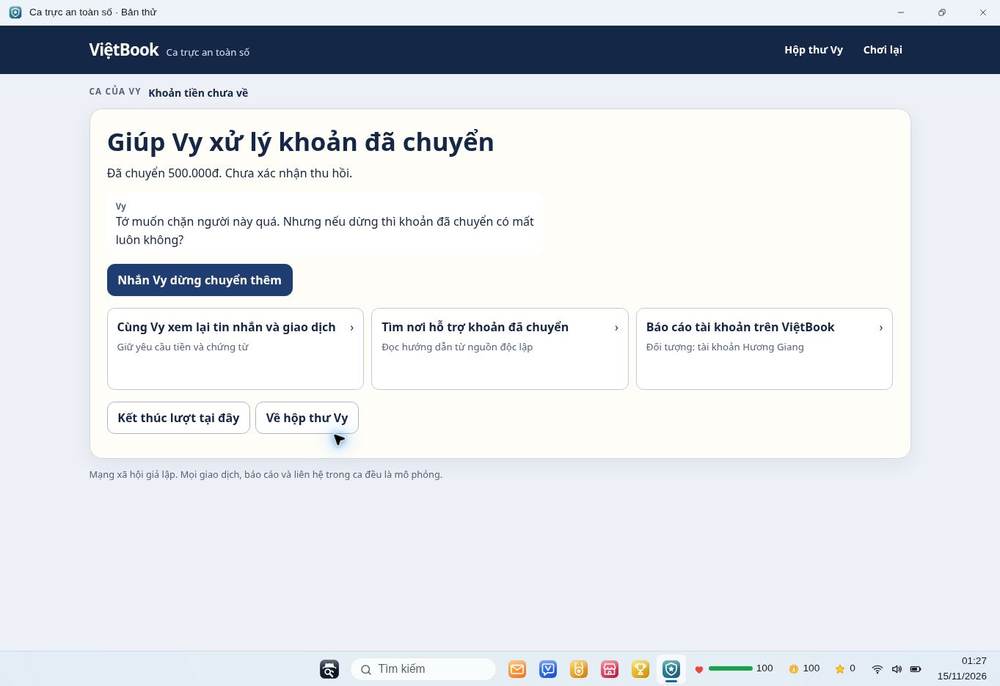
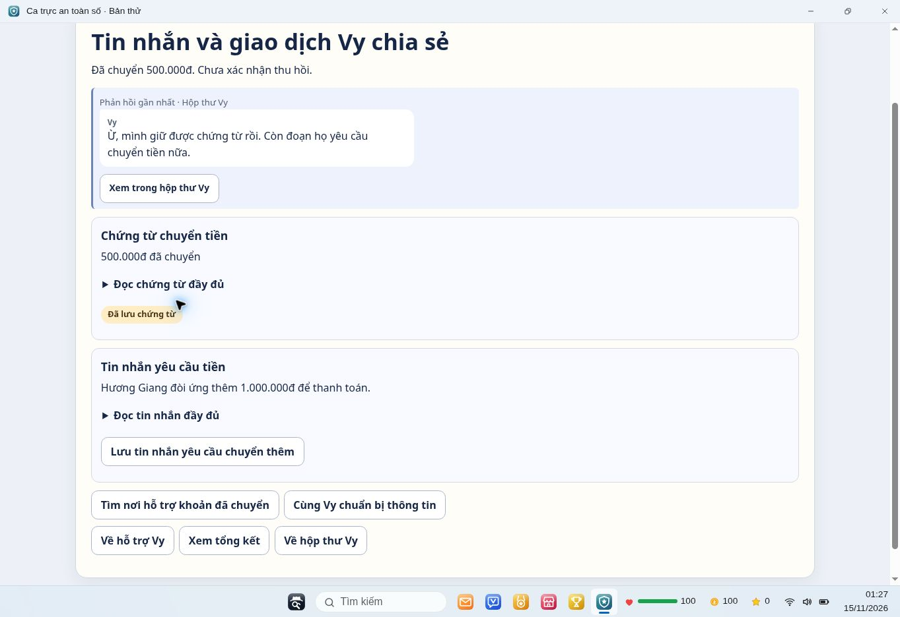
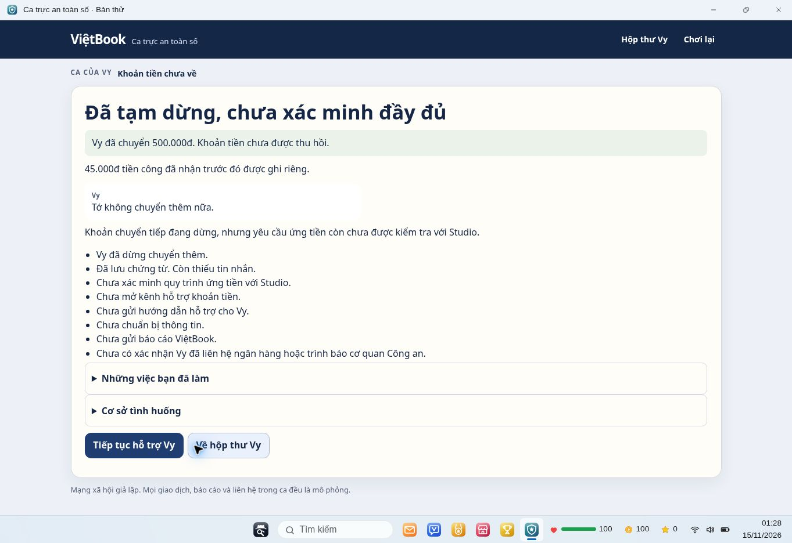

# Ca Vy — đoạn hỗ trợ sau chuyển tiền

Đường kiểm: https://thamtumang.github.io/game-goc.html → khách → Ca trực.

Mốc trước: `68b35e9df24b8323f7c0029f24a33da53cffaf70`.
Mã chạy mới đã quan sát trên Pages: `0ce04be29f9176dc3e99401b50f0f6faa6bcf122`, dấu phiên bản `ca-vy-support-v1`.
Đường nạp đã đối chiếu: `game-goc.html` → `js/game.js` → iframe `ca-truc/ban-thu/index.html` → `app.js`.

## Trước sửa

Đã chơi lượt khách qua tạm dừng, mở hỗ trợ, đọc và lưu chứng từ, về Vy rồi kết thúc. Kết quả trước sửa đã ghi đúng 500k và thiếu tin nhắn. Đây là quan sát nền cho thay đổi thiết kế, không phải bằng chứng rằng toàn bộ hỗ trợ cũ có lỗi.

## Phạm vi triển khai

- Một lời mở hỗ trợ theo trạng thái, ghi vào chính hộp thư Vy, tối đa một lần. Có lối xem lại lời mở.
- Ba hướng mở tự do: chứng cứ; hướng dẫn độc lập về khoản tiền; báo cáo ViệtBook. Không cần làm đủ để kết thúc.
- Hai loại chứng cứ có xem trước, mở đầy đủ và lưu riêng. Lưu tạo tin và phản hồi theo loại/những thứ còn thiếu; đọc không tự lưu.
- Hai thẻ nguồn độc lập mô phỏng: hướng ngân hàng và chuẩn bị trình báo Công an. Tách mở nguồn, nháp, gửi hướng dẫn, lưu bản chuẩn bị. Bản chuẩn bị có thể chưa kèm chứng cứ; không tự coi đầy đủ.
- Báo cáo nhắm tài khoản Hương Giang, có bản nháp, hủy và xác nhận. Lưu nội dung báo cáo tại thời điểm gửi; giao dịch sau không viết lại báo cáo cũ.
- Không xây bước xác nhận đã liên hệ, tiếp nhận hoặc thu hồi. Không thêm nút chặn; lời muốn chặn chỉ là động cơ mở cảnh. Giữ toàn bộ lịch sử đã chia sẻ.
- Bản chuẩn bị lưu thành phần hiện có; lưu thêm chứng cứ sau đó không tự viết lại bản cũ. Có thao tác cập nhật riêng.

## Kết quả qua giao diện

| Lượt | Thao tác và kết quả thực tế |
|---|---|
| A | Tạm chờ → hỗ trợ → nhắn Vy dừng → chỉ lưu chứng từ → kết thúc. 500k chưa thu hồi; thiếu tin nhắn; chưa xác minh, mở kênh, gửi hướng dẫn, chuẩn bị hay báo cáo. |
| B | Hỏi Studio về ứng tiền → gửi phản hồi để Vy dừng → mở thẻ hướng ngân hàng → xem nguồn → kết thúc. Chỉ ghi mở kênh, chưa gửi hướng dẫn hay liên hệ. |
| C | Tiếp tục B → soạn/hủy nháp hướng dẫn → soạn lại → đóng/mở Ca trực giữ nháp → gửi → lưu bản chuẩn bị khi chưa lưu chứng cứ → kết thúc. Hướng dẫn và bản chuẩn bị có phản hồi riêng; thiếu chứng cứ được ghi rõ; không có xác nhận liên hệ. |
| D | Khách sạch → báo cáo trước (xem đối tượng/nội dung, hủy rồi soạn lại, nhấp đúp xác nhận) → về lưu tin nhắn → mở hướng Công an → kết thúc. Một báo cáo, thiếu chứng từ, chỉ mở nguồn, chưa trình báo. Vy chưa chốt dừng được thể hiện đúng. |
| E | Khuyên tiếp → nhấp đúp xác nhận → hỗ trợ với tổng 1,5 triệu → nhắn dừng → xem đủ hai chứng từ → lưu chứng từ và tin nhắn → bản chuẩn bị → kết thúc. Chỉ có một lần chuyển thêm, 45k ghi riêng; cả hai loại chứng cứ được ghi nhận, tiền chưa thu hồi. |
| F | Giữ nháp báo cáo 1,5 triệu qua đóng/mở Ca trực rồi hủy; lời mở hỗ trợ không nhân đôi. Tải lại khách sạch lịch sử và các hành động; trở về 500k, chưa dừng, chưa lưu. Cũng thử hủy nháp hướng dẫn, xem lại nguồn và kết thúc mà không gửi. |
| G | Mở tài khoản thử có payment-v1 trước cập nhật: tin và kết thúc cũ còn, các trạng thái mở/gửi nguồn, chuẩn bị, báo cáo mới đều chưa làm. Kiểm tự động bổ sung trường hợp lượt cũ đã có chứng cứ/báo cáo/bản chuẩn bị nhưng thiếu chi tiết mới. |

Một lần click tự động “Gửi hướng dẫn cho Vy” ngay sau mở lại iframe không kích hoạt thao tác; DOM vẫn là nháp, không có lỗi ứng dụng được ghi nhận. Dùng Enter trên chính nút đó đã gửi một lần. Chưa tách được nguyên nhân ở công cụ điều khiển hay tương tác khi cửa sổ vừa mở; không khẳng định mọi click cảm ứng đã được kiểm.

## Kích thước, kiểm tra mã và giới hạn

- Desktop: iframe 1363×853 ở zoom 100%; ảnh trang 1363×936.
- Phóng to 200%: iframe 674×379. Nháp báo cáo không tràn ngang; Tab từ Xác nhận sang Hủy, hủy được.
- Bổ sung zoom 400%: iframe 337×145. Thẻ hỗ trợ và nháp hướng dẫn không tràn ngang, soạn/hủy/quay lại được. Không gọi đây là viewport điện thoại chuẩn.
- Chưa kiểm cảm ứng, viewport 360×800/390×844, trình đọc màn hình hoặc tài khoản Firebase thật.
- Không có cuộc gọi, gửi biểu mẫu, trình báo hay giao dịch thật nào được thực hiện.
- Đạt `node --check ca-truc/ban-thu/app.js`, `tests/vy-support.test.cjs`, `tests/vy-review.test.cjs`, `tests/shift.test.cjs`, `tests/demo-account.test.cjs`, `git diff --check`.

Kiểm thử trạng thái bao gồm: đọc khác lưu; mở khác gửi; hủy khác hoàn thành; một lần chuyển thêm; báo cáo có xác nhận; nháp báo cáo sai số tiền phải cập nhật; bản cũ không bị viết lại; dữ liệu cũ không tự có việc mới; log theo thứ tự.

Khóa `payment-v1` giữ nguyên. Các trường hỗ trợ mới dùng mặc định rỗng/false/null. Không đổi game gốc, ca Minh hoặc cơ chế lưu tài khoản. Riêng kết thúc chưa hề chốt dừng dùng tiêu đề “Chưa xác minh đầy đủ”, để không ghi giả “đã tạm dừng”; vẫn thuộc nhóm kết thúc chưa xác minh.

## Ảnh

Nguồn và giới hạn nội dung: [SOURCES.md](SOURCES.md). Độ hấp dẫn và hiệu quả học tập chưa được xác định; cần quan sát người chơi mới.
