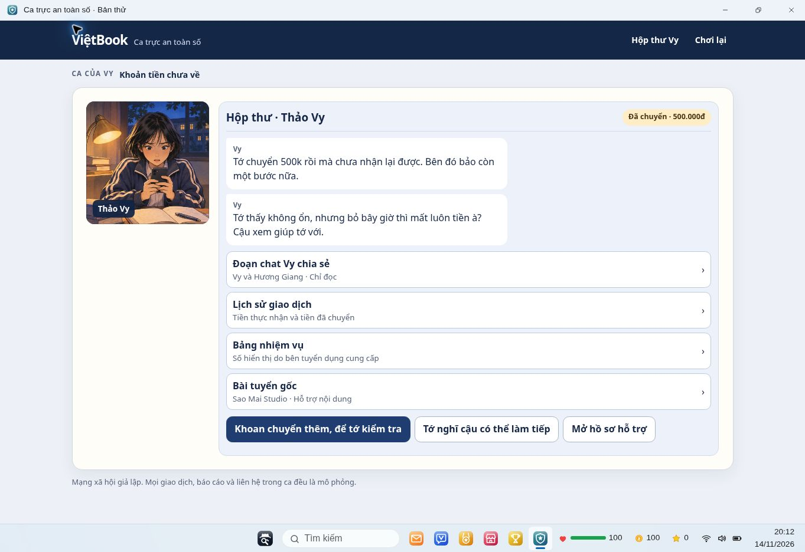
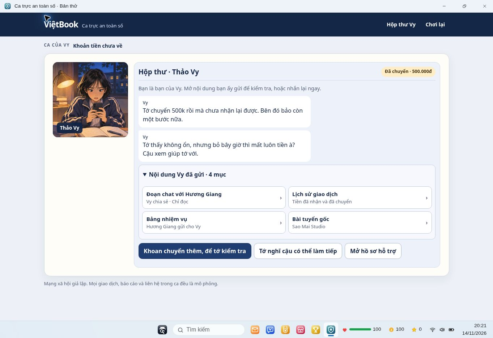
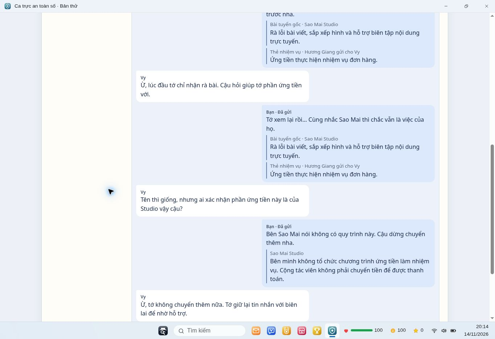
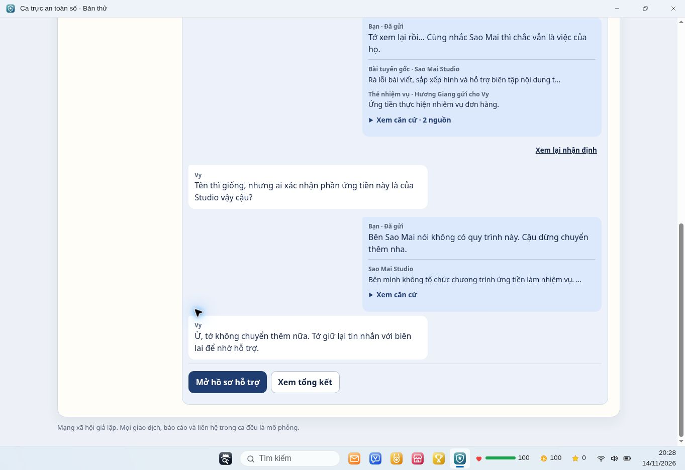
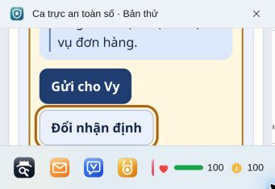
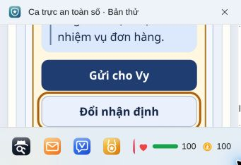

# Ca Vy — kiểm thử trình bày ViệtBook

Đường chạy: https://thamtumang.github.io/game-goc.html → khách → Ca trực.

Bản trước: `1e0bfc7097a32afaa2c5b2fb890b07852233b3c4`.
Bản giao diện đã quan sát: `da22b1155d81510c673540fce17beec86031ffb8`, dấu phiên bản `ca-vy-ui-v2`.

## Vấn đề quan sát và xử lý

- Bốn thẻ xếp dọc làm thao tác tạm dừng nằm thấp. Thẻ được xếp hai cột ở desktop, giữ một cột khi hẹp; thêm một câu nêu vai trò bạn của Vy.
- Trong lượt có nhiều tin, mở đầu và thẻ luôn nằm trên chat. Nay chúng thu gọn trong “Tin nhắn mở đầu” và “Nội dung Vy đã gửi”; vẫn mở lại được.
- Gửi hoặc sửa ý lặp toàn bộ trích đoạn. Lịch sử nay có nguồn và trích đoạn ngắn, “Xem căn cứ” mở đủ nguồn ngay trong tin. Bản nháp giữ đầy đủ. “Xem lại nhận định” nằm cạnh lần gửi gần nhất của từng nhóm, dùng để sửa lời nhắn.
- Cuộn trước đây chỉ nhắm lời Vy cuối cùng, có thể mất phần người chơi vừa gửi. Nay nhóm tin mới gồm lời người chơi, phản hồi Vy và hành động tiếp; chỉ tin mới mới kích hoạt cuộn tới nhóm này. Quay lại nguồn hoặc đóng/mở cửa sổ dùng vị trí đang đọc.
- Hộp thư Studio đã tìm được có đường quay lại cạnh lời đáp liên quan. Quyết định chuyển thêm, hỗ trợ và tổng kết nằm ngay sau phản hồi cuối.

## Lượt thực sự chạy trên web

| Lượt | Kết quả |
|---|---|
| Trước sửa | Chọn hai nguồn, gửi, sửa ý, tìm Studio, hỏi quy trình, gửi phản hồi, xem kết thúc 500k. Chụp mở đầu, chat dài, nháp ở zoom 400%. |
| A | Khách sạch → chat chia sẻ → thẻ nhiệm vụ → bài tuyển → trang Studio → hộp thư → hỏi quy trình → chuyển cho Vy → tổng kết. 500k chưa thu hồi. Đọc và đóng căn cứ đầy đủ không thêm tin. |
| B | Chọn hai trích đoạn → xem nháp → gửi → mở đủ hai nguồn → sửa → hủy → sửa lại → đóng riêng Ca trực → mở lại nháp → gửi sửa. Tin cũ còn, hai nhận định có lịch sử riêng. Sau đó xác minh và sửa sang ý khuyên tin: Vy vẫn dừng, không mở lại giao dịch. |
| C | Khuyên chuyển → xác nhận bằng nhấp đúp → 1,5 triệu một lần → hỗ trợ → nhắn dừng → lưu chứng từ → tổng kết còn thiếu tin nhắn → lưu tin nhắn → chuẩn bị hồ sơ → báo cáo ViệtBook → tổng kết. Hồ sơ, báo cáo tách riêng; tiền chưa thu hồi. |
| Bổ sung | Dừng ngay vẫn kết thúc được. Tải lại khách sạch tin, lựa chọn, nháp và hành động. Tài khoản thử có lượt payment-v1 từ trước tiếp tục được; tin, kết quả và các nhận định cũ còn nguyên. |

Trong lượt dài, cặp tin mới và hành động tiếp đều nằm trong vùng nhìn desktop. Đóng rồi mở lại riêng cửa sổ khi đang đọc nguồn cũ giữ vị trí cuộn đo được `404 → 404`.

Bàn phím: mở/đóng căn cứ bằng Enter, đóng trả focus về summary; nháp nhận focus ở Gửi, Tab sang Đổi nhận định; hủy và đóng bộ soạn không gửi. Hai lựa chọn nhận định cùng kiểu, không mã màu đáp án.

## Kích thước và giới hạn

- Chrome desktop thực tế: ảnh 1363×936; vùng iframe ca Vy 1363×853 ở 100%. Nút tạm dừng mới nằm từ y≈638 đến y≈682 trong iframe. Không ghi đây là phép đo 1366×768.
- Phóng to 200%: iframe 674×379, không tràn ngang; đọc đủ hai nguồn trong nháp và dùng được Gửi/Đổi/Bỏ nháp.
- Kiểm hẹp bổ sung bằng zoom 400%: iframe 337×145, ảnh trang 337×234. Không tràn ngang; thao tác đổi, bỏ, đóng, xem lại và gửi sửa dùng được. Ảnh nháp hẹp chụp phần nút ở cuối nháp.
- Chưa chạy viewport điện thoại 360×800/390×844, cảm ứng, trình đọc màn hình hoặc tài khoản Firebase thật. DevTools của trình duyệt này bị chính sách môi trường chặn; không coi zoom là kiểm thiết bị di động.
- CSS reduced-motion hiện có được giữ; không thêm hiệu ứng hay âm thanh. Chưa đổi tùy chọn hệ điều hành để kiểm trực tiếp reduced motion.

## Ảnh trước/sau

| Màn | Trước | Sau |
|---|---|---|
| Mở đầu |  |  |
| Chat dài |  |  |
| Cuối nháp ở zoom 400% |  |  |

## Kiểm tra mã

`node --check ca-truc/ban-thu/app.js`, `node tests/vy-review.test.cjs`, `node tests/shift.test.cjs`, `node tests/demo-account.test.cjs`, `git diff --check` đều đạt.

Giữ khóa `payment-v1`; trường trình bày mới có mặc định cho dữ liệu cũ. Không thay cơ chế lưu, câu chuyện, số tiền, kết thúc hay ca Minh. Ngoài trình bày, bổ sung ghi nhớ vị trí cuộn và trạng thái mở mục đọc nguồn; đây không được tính là hành động gửi/xác minh.
